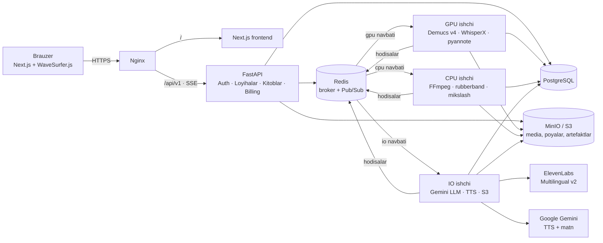

# Audiyo — oʻzbekcha AI video dublyaj va audiokitob platformasi

Chet tilidagi video/audio kontentni oʻzbekcha dublyajga, kitob va uzun matnlarni esa koʻp ovozli audiokitobga aylantiradi.

- **Video:** ovozni ajratish → STT + spikerlar → davomiylikka moslashgan tarjima → koʻp provayderli TTS → pitch saqlovchi vaqt moslash → sidechain mikslash → MP4/MKV + SRT/VTT.
- **Kitob:** EPUB/FB2/DOCX/PDF/TXT → boblar va dialog bloklari (≤ 2000 belgi) → personajlar reyestri → talaffuz leksikoni → TTS → M4B (bob belgilari bilan) + MP3.
- **Veb UI:** WaveSurfer.js koʻp yoʻlakchali vaqt jadvali, ssenariy tahriri, ovoz aktyorini almashtirish, qayta render, real vaqt progress (SSE), hisob-kitob.

Texnik topshiriq: [`docs/TECHNICAL_SPEC.md`](docs/TECHNICAL_SPEC.md), [`docs/BOOK_TTS_MODULE.md`](docs/BOOK_TTS_MODULE.md).

## Arxitektura



### Video holat mashinasi

`UPLOADED → STEM_SEPARATION → TRANSCRIBED → TRANSLATED → TTS_DISPATCHED → TIMING_ALIGNED → MASTERED → READY_FOR_EXPORT` (har qanday bosqichdan `FAILED`, undan `retry`).

| Bosqich | Navbat | Amalga oshirish |
|---|---|---|
| Ovozni ajratish | gpu | FFmpeg demux → Demucs `htdemucs --two-stems vocals` → `vocals` + `accompaniment` (FLAC) + toʻlqin choʻqqilari |
| STT + diarizatsiya | gpu | WhisperX (soʻz vaqtlari) + pyannote (spikerlar) + F0 boʻyicha jins/yosh; ≤ 12 s segmentlar |
| Tarjima | io | Gemini JSON rejimi; boʻgʻin byudjeti `duration × 5.5 × 1.25`; oshganlar qisqartirish uchun qayta yuboriladi |
| TTS | io | Spiker darajasida tier + ovoz; retry/backoff, circuit breaker, sticky fallback; kredit HOLD → SETTLE |
| Vaqt moslash | cpu | `rubberband` (yoki `atempo`) 0.85–1.25×; keyingi segmentgacha boʻshliqdan qarz; sigʻmasa — avtomatik qisqa tarjima |
| Mastering | cpu | Dialog yoʻlakchasi → `sidechaincompress` ducking → `loudnorm −16 LUFS` → MP4 (dublyaj + asl audio + subtitr) |

### TTS marshrutlash

| Daraja | Provayder | Kim |
|---|---|---|
| TIER_1 | ElevenLabs Multilingual v2 | nutq ulushi ≥ 15%, yoki ≥ 5% va emotsional segmentlar ≥ 35%, klonlangan ovozlar (≤ 4 ta) |
| TIER_2 | Gemini TTS | qolgan spikerlar, monologlar, `BUDGET` rejimi |

Xarajat: `api_cost = chars/1000 × narx_1k + audio_s × narx_s`, mijozdan `api_cost × PLATFORM_MARKUP`. TTS oldidan taxminiy summa **HOLD**, oxirida haqiqiy sarf boʻyicha **SETTLE**. Har soʻrov `tts_jobs` da (provayder, fallback, kechikish, retry, narx).

## Ishga tushirish

```bash
cp .env.example .env              # JWT_SECRET, GEMINI_API_KEY, ELEVENLABS_API_KEY, HF_TOKEN
docker compose up -d --build      # GPU (NVIDIA Container Toolkit) bilan
# GPU yoʻq boʻlsa:
docker compose -f docker-compose.yml -f docker-compose.cpu.yml up -d --build
```

Ochish: http://localhost · API hujjatlari (Swagger): http://localhost/api/docs · MinIO konsoli: http://localhost:9001

### Mahalliy ishlab chiqish

```bash
# Backend
cd backend && python -m venv .venv && . .venv/bin/activate
pip install -r requirements-dev.txt
python -m app.migrate
uvicorn app.main:app --reload
celery -A app.workers.celery_app worker -Q gpu,cpu,io -c 2   # GPU paketlarisiz: demucs zaxira usuli
# Frontend
cd frontend && npm install && npm run dev                    # http://localhost:3000 (/api → :8000)
```

### Testlar

```bash
cd backend && pytest            # 46 test; integratsion testlar Postgres + Redis + ffmpeg talab qiladi
cd frontend && npm run typecheck && npm run build
```

Integratsion testlar API → Celery → Postgres → FFmpeg toʻliq zanjirini (video va kitob) tekshiradi; faqat S3, WhisperX, LLM va TTS soxtalashtirilgan.

## API (asosiy)

| Metod | Yoʻl | Tavsif |
|---|---|---|
| POST | `/api/v1/auth/register`, `/auth/login` | JWT |
| POST | `/api/v1/projects/upload` | video yuklash (multipart) va konveyerni boshlash |
| GET | `/api/v1/projects/{id}/timeline` | segmentlar, spikerlar, poyalar URL, toʻlqin choʻqqilari |
| PATCH | `/api/v1/projects/{id}/segments/{segment_id}` | matn / spiker / emotsiya / vaqt tahriri |
| PATCH | `/api/v1/projects/{id}/speakers/{speaker_id}` | ovoz aktyorini almashtirish |
| POST | `/api/v1/projects/{id}/speakers/{speaker_id}/clone` | ElevenLabs ovoz klonlash |
| POST | `/api/v1/projects/{id}/rerender` · `/retry` · `/start-tts` | faqat kerakli bosqichlarni qayta ishlatish |
| GET | `/api/v1/projects/{id}/export` · `/costs` · `/events` (SSE) | eksport havolalari, xarajat, real vaqt |
| POST | `/api/v1/books/upload` | kitob yuklash |
| GET/PATCH | `/api/v1/books/{id}/blocks`, `/characters`, `/lexicon` | tekshirish va tahrir |
| GET/POST | `/api/v1/books/{id}/estimate`, `/synthesize`, `/export`, `/events` | narx, sintez, M4B/MP3 |
| GET | `/api/v1/billing/balance` · `/transactions` · `/usage` | hisob-kitob |
| POST | `/api/v1/billing/webhook` | toʻlov provayderi (HMAC-SHA256 imzo) |

SSE hodisa sxemasi: `{type, entity, id, status, stage, progress, message, data, ts}` — `type ∈ snapshot | status | progress | segment | block | cost | error`.

## Loyiha tuzilmasi

```
backend/   FastAPI, SQLAlchemy, Celery ishchilari, migrations/, tests/
frontend/  Next.js App Router, Tailwind v4, WaveSurfer.js
infra/     Nginx
design-system/audiyo/MASTER.md  UI dizayn tizimi (ui-ux-pro-max skill)
```

## Cheklovlar va keyingi qadamlar

- Toʻlov: umumiy imzolangan webhook bor; Payme/Click adapterlari alohida yozilishi kerak.
- Provayder narxlari va model nomlari `.env` orqali sozlanadi — joriy tariflarga moslang.
- Ovoz klonlash faqat foydalanuvchi huquqiga ega boʻlgan ovozlar uchun (UI tasdiq soʻraydi).
